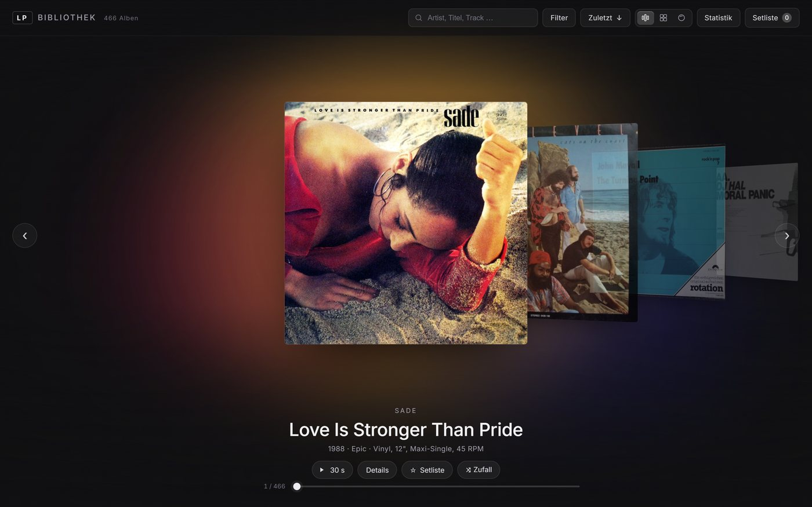
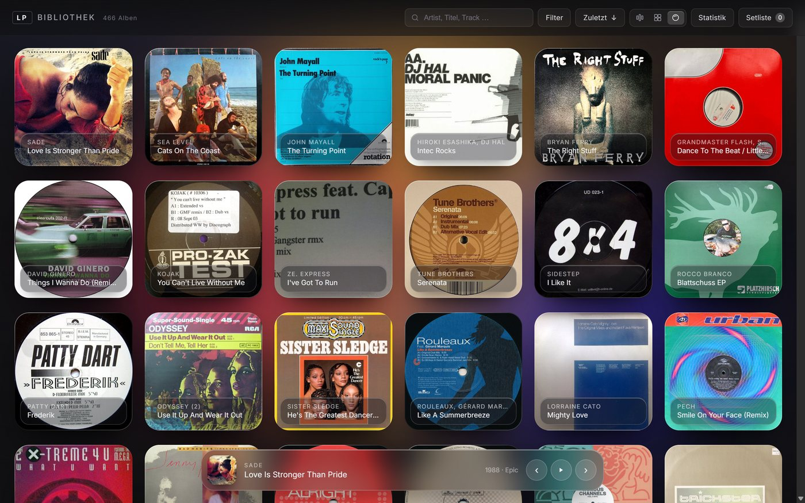
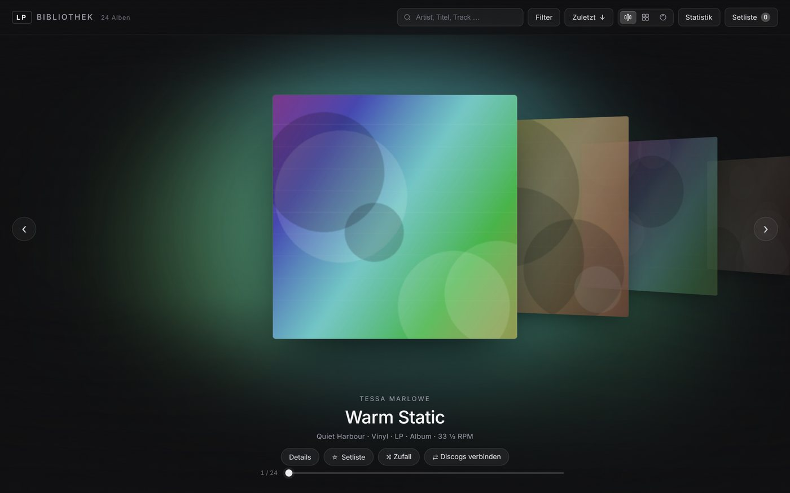
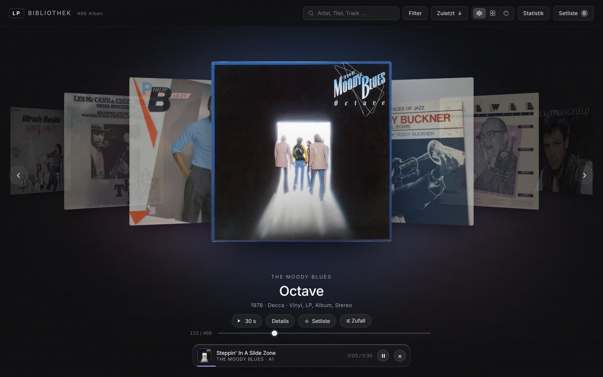

# LP · Bibliothek

Deine Discogs-Sammlung als durchblätterbarer Katalog: Cover-Flow mit farbigem Backglow,
Liquid-Glass-Wand, Setlisten für Live-Mixe, 30-Sekunden-Vorschauen pro Track.
Sync-Skript (Python) + statische Seite (Vanilla JS) – **kein Backend, kein Build, keine Cloud**.





## Was drin ist

- **Drei Ansichten** – Cover-Flow (ein Cover groß, Nachbarn perspektivisch gestaffelt),
  Raster und eine Glas-Wand mit transluzenten Kacheln.
- **Detailansicht** – großes Cover, Tracklist mit Position/Dauer, Label, Katalognummer,
  Genre, Styles, Land, Format, Datum des Hinzufügens, Link zu Discogs.
- **Suchen, filtern, sortieren** – Volltext über Artist/Titel/Label/Tracknamen; Filter für
  Medium (Vinyl, Cassette …), Genre, Style, Label, Jahrzehnt und eigene Tags; sechs
  Sortierfelder. Zustand bleibt beim Neuladen erhalten.
- **Setlisten für den Livemix** – mehrere benannte Listen, Drag & Drop, pro Eintrag BPM,
  Camelot-Key, Energie 1–5, Notiz und Trackauswahl; Gesamtdauer gegen ein Ziel,
  Energie-Kurve, Übergangsvorschläge, Export als Text/CSV/JSON, JSON-Import, Druckansicht.
- **30-Sekunden-Vorschauen** pro Track (optional, siehe unten).
- **Statistik** – Alben, Tracks, Labels, Genres, Jahrzehnte, Zugänge pro Monat, Lücken.
- **Gig-Modus** – Vollbild fürs Tablet am Pult, Wake Lock, Blättern per Wisch.
- Läuft nach dem Sync **offline**; die Seite ist reines HTML/CSS/JS.

## Schnellstart

Voraussetzung: **Python 3.9+** (Windows: bei der Installation „Add python.exe to PATH“ anhaken).

1. **Laden** – `git clone https://github.com/CommonGroundLabs/lp-bibliothek.git`
   oder „Code → Download ZIP“ und entpacken.
2. **Starten** – im Ordner:
   - Windows: Doppelklick auf **`setup.cmd`**
   - macOS/Linux: `python3 setup.py`
3. **Verbinden** – der Browser öffnet `http://127.0.0.1:8765` und fragt nach
   Discogs-Benutzername und Personal Access Token
   ([hier erzeugen](https://www.discogs.com/settings/developers) → „Generate new token“).
   Danach „Sammlung laden“ – der Fortschritt läuft im Fenster mit.

Fertig. Beim nächsten Mal genügt `start.cmd` bzw. `./start.sh` oder
`python3 app_server.py --open`.



## Was mit dem Token passiert

Der Token wird **nur an den lokalen Server auf deinem Rechner** geschickt, dort geprüft und
in `.env` gespeichert (in `.gitignore`, Dateirechte 600). Er taucht in keiner API-Antwort,
keinem Log und keinem Frontend-Bundle auf. Auf einem öffentlichen Webspace gibt es diese
Endpunkte nicht – dort ist die Seite rein statisch.

Alternativ von Hand: `.env` anlegen mit

```
DISCOGS_USER=dein_benutzername
DISCOGS_TOKEN=dein_personal_access_token
```

## Ohne Account erst mal ansehen

Im Einrichtungsfenster auf **„Erst mal Demo ansehen“** – es entstehen 24 synthetische Alben
mit generierten Covern (`meta.fixture = true`, die Seite weist darauf hin). Der nächste echte
Sync überschreibt alles.

## Sammlung aktualisieren

```bash
python3 sync.py            # inkrementell: neue/entfernte Releases abgleichen
python3 sync.py --force    # alle Details neu laden
python3 sync.py --limit 20 # Testlauf
python3 sync.py --check    # nur Token und Benutzer prüfen
```

Der erste Lauf holt pro Release Details und Cover – bei ~60 Requests/Minute dauert das für
500 Alben rund 20 Minuten, danach nur noch die Deltas. `Ctrl+C` ist jederzeit möglich
(geschrieben wird am Ende). Ergebnis:

```
web/collection.json   # Sammlung inkl. Tracklists, Formate, dominanter Farben
web/covers/*.jpg      # lokal ausgelieferte Cover (max. 1100 px)
```

## Vorschauen (optional)

```bash
python3 sync_previews.py                # alle Alben
python3 sync_previews.py --limit 20     # Testlauf
python3 sync_previews.py --retry-missed # Fehlschläge erneut versuchen
```

Quelle ist die iTunes-Search-API (Apple Music): kein Key, keine Anmeldung, pro Track eine
30-Sekunden-URL. Es wird **nichts heruntergeladen**, nur gestreamt. Erwartbar sind ~70 % der
Alben – 12"-Singles kleiner Labels fehlen bei Apple Music oft; die Detailansicht sagt das
dann offen. Jede Vorschau zeigt ihre Quelle im Tooltip (`Quelle: …`).



## Bedienung

| Aktion | Desktop | Mobil |
|---|---|---|
| blättern | ← → ↑ ↓, Mausrad, Klick auf Nachbarcover, Slider | Wischen |
| Details | Klick aufs mittlere Cover, `Enter` | Tipp aufs Cover |
| schließen | `Esc`, Klick außerhalb | Zurück / × |
| Ansicht | Umschalter in der Kopfzeile (Flow · Raster · Glas) | dito |
| Suche | Suchfeld (Artist, Titel, Label, Tracks) | Suchfeld |
| Zufall | `R` oder „⤨ Zufall“ | Button |
| Setlisten | `S` oder „Setliste“ | Button |
| Filter | `F` | Button |
| Vorschau | `P` oder `▷` am Track | `▷` |

Eigene Notizen (Setlisten, BPM/Key/Energie, Tags) bleiben im `localStorage` des Browsers und
werden nie an Discogs oder sonst wohin geschickt.

## Nur die Seite hosten

Nach dem Sync genügt der Ordner `web/` (HTML, CSS, JS, `collection.json`, `covers/`) – per
FTP/SFTP auf den Webspace kopieren, fertig. Kein PHP, kein Node, keine Datenbank.
Relative Pfade funktionieren auch in einem Unterordner wie `https://example.org/lps/`.

`collection.json`, `previews.json` und `covers/` sind bewusst **nicht** im Repo: sie gehören
zur jeweiligen Sammlung.

## Struktur

```
lp-bibliothek/
├─ setup.py / setup.cmd     # Erststart: Abhängigkeiten prüfen, Server + Browser
├─ app_server.py            # lokaler Server + Einrichtungs-API (/api/connect, /api/sync …)
├─ sync.py                  # Discogs-Sync: Details, Cover, dominante Farben
├─ sync_previews.py         # 30-s-Vorschauen (iTunes Search API)
├─ start.cmd / start.sh     # täglicher Start
├─ dev/make_fixture.py      # synthetische Demo-Daten
├─ docs/                    # Screenshots für diese README
└─ web/
   ├─ index.html
   ├─ style.css
   ├─ app.js                # Flow, Filter, Detail, Setlisten, Vorschau, Einrichtung
   ├─ collection.json       # entsteht beim Sync
   └─ covers/               # entsteht beim Sync
```

## Technische Notizen

- **Virtualisierter Cover-Flow**: nur 5–9 Cover-Elemente im DOM, unabhängig von der
  Sammlungsgröße; Positionen werden über `transform` animiert (60 fps).
- **Glow** aus den dominanten Cover-Farben (Median-Cut + Hue-Diversifizierung, berechnet
  beim Sync), weicher Farbwechsel über drei geblurrte Flächen.
- **Sicherheit**: Token nur lokal; alle Discogs-Felder im Frontend HTML-escaped;
  API-Endpunkte des Assistenten antworten ausschließlich auf `127.0.0.1`/`localhost`.
- **Barrierefreiheit**: Covers sind Buttons mit Alt-Text, Detail ist ein `role="dialog"`
  mit Fokus-Rückgabe, sichtbarer Fokusring, `prefers-reduced-motion` wird respektiert.
- **Fehlerfälle**: fehlendes Cover → Farbverlauf mit Initialen, fehlende Tracklist →
  Hinweis, fehlendes Jahr → „unbekannt“ (nie 0).
- **Cache-Busting**: `index.html` lädt `style.css?v=N` / `app.js?v=N` – nach Änderungen
  die Zahl erhöhen.

## Bekannte Grenzen

- 12"-Singles kleiner Labels haben oft keine Apple-Music-Vorschau (kein Fehler, nur Lücke).
- Der Sync braucht eine Internetverbindung zu Discogs; die Seite selbst läuft danach ohne.
- Setlisten und Metadaten hängen am Browser-Profil – für ein zweites Gerät die JSON-Datei
  exportieren und dort importieren.

## Lizenz

MIT – siehe [LICENSE](LICENSE). Discogs-Daten und Cover gehören ihren Rechten; das Projekt
lädt sie nur für den privaten Gebrauch.
